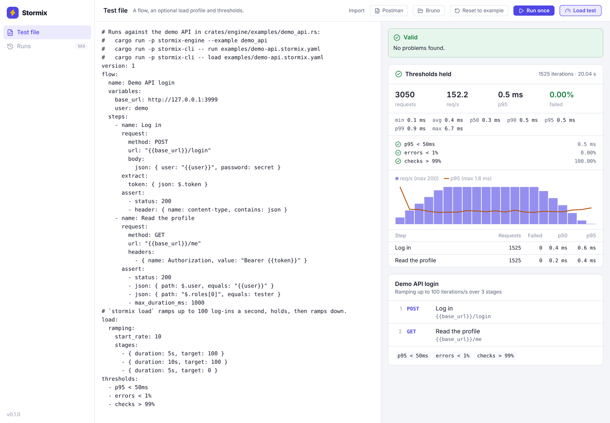
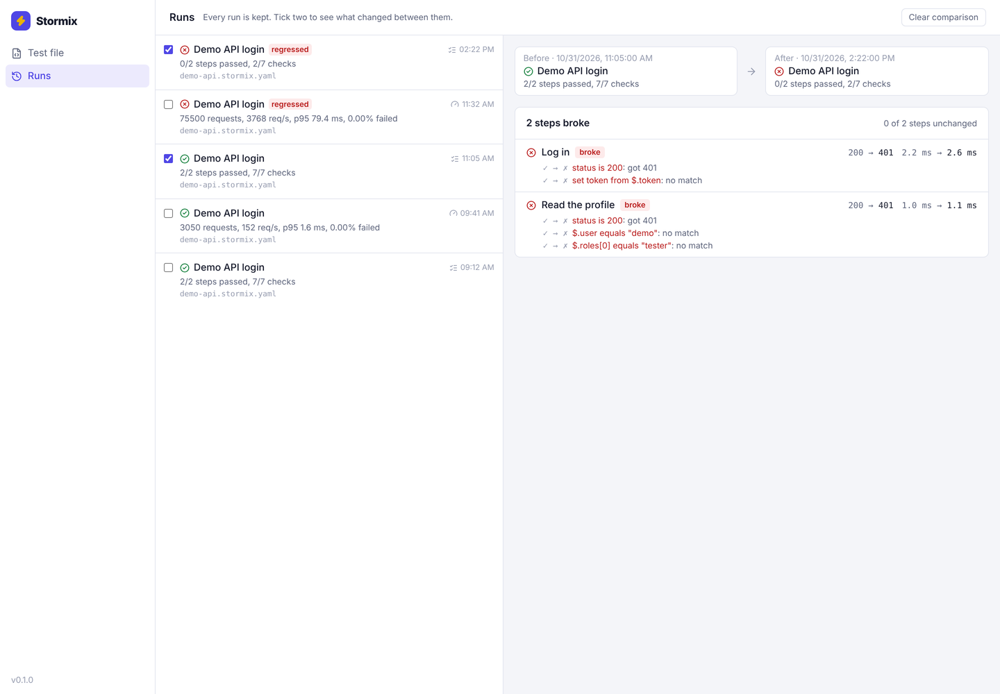
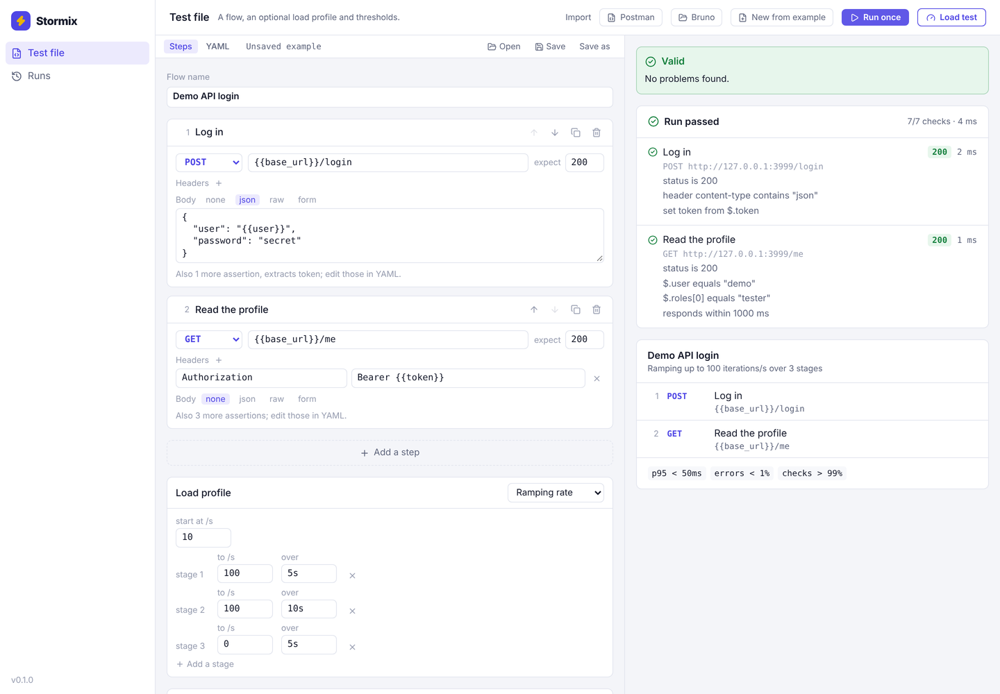
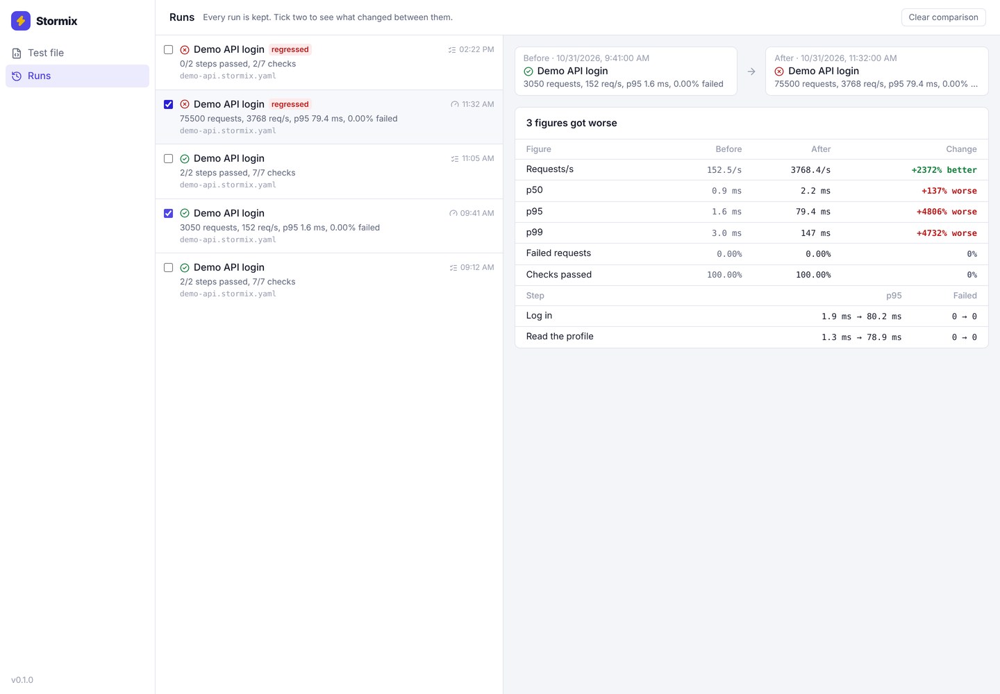

# Stormix

Stress test APIs and run collection flows, from a desktop app or the command line.

Stormix is a free, open source alternative to k6 with a GUI. It does two jobs with one engine:

- **Load and stress testing** of HTTP APIs, with constant-rate, ramping and virtual-user load models, latency percentiles and pass/fail thresholds.
- **Non-regression runs** of the flows in your Postman and Bruno collections: chained requests, variables passed between steps, assertions and the collections' own scripts.

A flow that passes as a regression test can be replayed by hundreds of users as a load test, and the `stormix` CLI runs the same files in CI.

> **Status:** 1.0. Installers for macOS, Windows and Linux, and the `stormix` CLI, are on the [Releases page](https://github.com/Iruora/StormiX/releases). See the [changelog](CHANGELOG.md) and the [roadmap](docs/ROADMAP.md).



## Install

Download the desktop app (`.dmg`, `.exe`/`.msi`, `.AppImage`/`.deb`/`.rpm`) or the CLI archive for your platform from the [latest release](https://github.com/Iruora/StormiX/releases/latest). The builds are not signed yet; [Getting started](docs/GETTING_STARTED.md#install) says how to open them the first time.

## Documentation

| | |
|---|---|
| [Getting started](docs/GETTING_STARTED.md) | From install to a regression run, a load test and CI, in ten minutes |
| [Test files](docs/TEST_FILE.md) | Every field of the YAML format: steps, assertions, variables, load profiles, thresholds |
| [CLI](docs/CLI.md) | Every command, option and exit code |
| [Collections](docs/COLLECTIONS.md) | Running Postman and Bruno collections, scripts included |
| [Compatibility](docs/COMPATIBILITY.md) | What carries over from Postman, Bruno and k6, feature by feature |

## Test files

A test file is YAML: a flow, an optional load profile and thresholds. `stormix init` writes [this example](examples/login.stormix.yaml).

```yaml
version: 1
flow:
  name: Log in, then read the profile
  variables:
    base_url: https://api.example.com
  steps:
    - name: Log in
      request:
        method: POST
        url: "{{base_url}}/login"
        body:
          json: { user: demo, password: secret }
      extract:
        token: { json: $.token }
      assert:
        - status: 200
    - name: Read the profile
      request:
        method: GET
        url: "{{base_url}}/me"
        headers:
          - { name: Authorization, value: "Bearer {{token}}" }
load:
  ramping:
    stages:
      - { duration: 30s, target: 20 }
      - { duration: 1m, target: 20 }
thresholds:
  - p95 < 500ms
  - errors < 1%
```

| Section | Options |
|---|---|
| `extract` | `json` (JSONPath), `header`, `regex` |
| `assert` | `status`, `max_duration_ms`, `header` (`equals`, `contains`), `json` (`path`, `equals`, `exists`), `body_contains` |
| `load` | `constant_rate` (`rate`, `duration`), `ramping` (`start_rate`, `stages`), `virtual_users` (`count`, `duration`, `think_time`) |
| `thresholds` | `p50`…`p99`, `avg`, `max` (ms or s), `errors`, `checks` (%), `rps` |

`{{name}}` is filled in from, last one winning: the flow's `variables`, an `--env` file, `--var` on the command line, then values earlier steps extract. `{{$guid}}`, `{{$timestamp}}`, `{{$timestampMs}}` and `{{$randomInt}}` are generated for each use.

A step can also carry `scripts: { pre_request: ..., test: ... }`, JavaScript in the Postman or Bruno style. Imported collections use them; see [Collections](docs/COLLECTIONS.md).

## Load tests

`stormix load` runs the flow under the file's `load` profile, shows live progress, and exits with 1 when a threshold fails, so it can gate a CI pipeline. The desktop app's **Load test** button does the same with a live chart.

```sh
stormix load examples/demo-api.stormix.yaml
stormix load my-api.postman_collection.json --vus 20 --duration 1m --threshold "p95 < 300ms"
stormix load stormix.yaml --rate 200 --duration 30s --out report.json --junit load.xml
```

```
Demo API login · ramping from 10/s: 100/s over 5s, 100/s over 10s, 0/s over 5s (20s in all)

  requests    3050 (152.2/s), 0 failed (0.00%)
  iterations  1525, 0 failed
  checks      10675/10675 passed (100.00%)
  latency     min 0.1 ms  avg 0.4 ms  p50 0.3 ms  p90 0.5 ms  p95 0.5 ms  p99 0.9 ms  max 6.7 ms

  step              requests  failed        p50        p95        p99
  Log in                1525       0     0.4 ms     0.6 ms     0.9 ms
  Read the profile      1525       0     0.2 ms     0.4 ms     0.6 ms

  thresholds
    ✓ p95 < 50ms           0.5 ms
    ✓ errors < 1%          0.00%
    ✓ checks > 99%         100.00%
```

| Model | Meaning |
|---|---|
| `constant_rate` | Starts `rate` flow iterations a second for `duration`, however slow the API gets (an open model) |
| `ramping` | Like `constant_rate`, moving linearly from `start_rate` to each stage's `target` over its `duration` |
| `virtual_users` | `count` users each loop the flow for `duration`, pausing `think_time` between iterations (a closed model) |

Latency is measured per request with HDR histograms, so percentiles are exact to three significant digits at any volume. A request counts as failed when no response came back, a check on it failed, or, if nothing checks it, its status is 4xx or 5xx. In open models, iterations due while `--max-in-flight` (1000) are already running are dropped and reported, rather than silently slowing the arrival rate. When the test ends, running iterations get `--grace` (30s) to finish.

| Option | |
|---|---|
| `--vus N`, `--rate N` with `--duration`, `--think-time` | Replace the file's load profile (collections have none) |
| `--duration` alone | Change the length of a constant-rate or virtual-user profile |
| `--threshold RULE` | Add a threshold; repeatable |
| `--out FILE`, `--junit FILE`, `--html FILE`, `--format json` | Full JSON report, one JUnit test case per threshold, a self-contained HTML report, or JSON on stdout |
| `--max-in-flight N`, `--grace 30s`, `-q` | Cap on concurrent iterations, finishing time at the end, no live progress |

`bench/compare.sh` runs the same flow with Stormix and k6 under the same load; CI publishes the comparison on each run.

## Desktop app

Open a test file or import a Postman or Bruno collection, then edit it as steps (method, URL, headers, body, expected status, load profile, thresholds) or as YAML. **Run once** checks the flow; **Load test** runs it under its load profile with a live chart.

Every run is kept in a local history (`runs.db` in the app's data folder). On the **Runs** page, open a run to export it as JSON or JUnit, or tick two runs to compare them: which steps broke or were fixed and which checks changed, or, for load tests, how throughput and latency moved (more than 10% counts as worse or better).



| | |
|---|---|
|  |  |

## Collections

`stormix run` takes a Postman collection export (`.json`) or a Bruno collection folder directly, and runs its pre-request scripts, test scripts and assertions in an embedded JavaScript engine. `stormix import` turns one into a test file. [docs/COLLECTIONS.md](docs/COLLECTIONS.md) lists what carries over and what does not yet.

```sh
stormix run my-api.postman_collection.json --env staging.postman_environment.json
stormix run ./my-bruno-collection --env local --junit report.xml
stormix import ./my-bruno-collection -o my-api.stormix.yaml
```

## CLI

```sh
stormix init                                   # write stormix.yaml
stormix validate stormix.yaml
stormix run stormix.yaml --env staging.json --junit report.xml --html report.html
stormix load stormix.yaml --threshold "p95 < 300ms"
stormix import collection.json -o stormix.yaml # Postman export or Bruno folder
```

`run` exits with 1 when a check fails, `load` when a threshold fails, and both with 2 when the file cannot be run. The [CLI reference](docs/CLI.md) has every option. From a checkout, use `cargo run -p stormix-cli -- <command>`.

## Development

You need Rust (stable), Node 22 and pnpm. On Linux, also the [Tauri system dependencies](https://v2.tauri.app/start/prerequisites/#linux).

```sh
cd apps/desktop
pnpm install
pnpm tauri dev                 # run the desktop app
cd ../..
cargo test --workspace         # also regenerates apps/desktop/src/bindings.ts
cargo clippy --workspace --all-targets -- -D warnings
```

## Repository layout

```
apps/desktop/        Tauri app: src-tauri/ (Rust shell, IPC) and src/ (React UI)
crates/flow/         flow model, test file format, validation (no Tauri deps)
crates/engine/       runs flows once or under load: HTTP client, variables, assertions, JUnit
crates/metrics/      HDR latency histograms, load summaries, threshold checks
crates/script/       sandboxed QuickJS for Postman (`pm.*`) and Bruno (`bru.*`) scripts
crates/collections/  Postman and Bruno importers
crates/store/        run history (SQLite) and run-to-run diffs
crates/report/       self-contained HTML reports
crates/cli/          `stormix`, the command line for CI and quick runs
examples/            example test files, and fixture collections CI runs against the demo API
bench/               the k6 comparison
```

## License

Licensed under either of [Apache License 2.0](LICENSE-APACHE) or [MIT](LICENSE-MIT), at your option.
