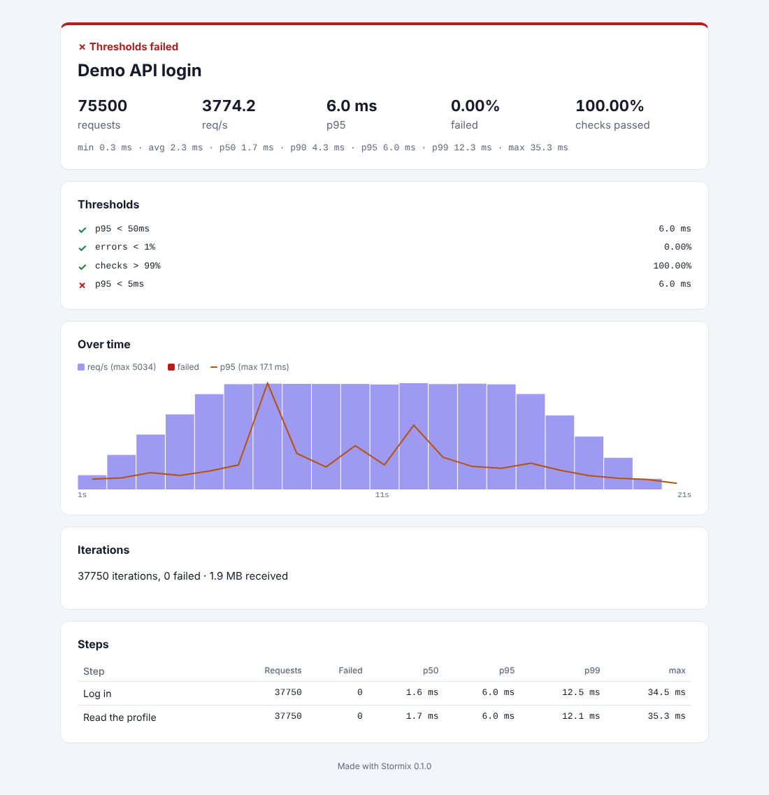

# Getting started

This guide takes you from nothing to a regression run and a load test in about ten minutes, first in the desktop app, then from the command line and in CI.

## Install

Download the latest release from the [Releases page](https://github.com/Iruora/StormiX/releases):

| You want | Download |
|---|---|
| The desktop app on macOS | `Stormix_<version>_aarch64.dmg` (Apple silicon) or `_x64.dmg` (Intel) |
| The desktop app on Windows | `Stormix_<version>_x64-setup.exe` or the `.msi`, `_x64_installer.zip` (both installers in one zip), or `_x64_portable.zip` to run without installing |
| The desktop app on Linux | `.AppImage`, `.deb` or `.rpm` |
| Only the command line | `stormix-cli_<version>_<platform>.tar.gz` or `.zip`; put `stormix` on your `PATH` |

The builds are not signed yet. On macOS, right-click the app and choose **Open** the first time. On Windows, choose **More info**, then **Run anyway**.

## 1. A first test in the app

1. Open Stormix. The **Test file** screen opens with an example flow.
2. Click **Postman** or **Bruno** under *Import* and pick your collection: a Postman `.json` export, or a Bruno collection folder. Pick an environment in the list that appears next to the buttons.
3. The right-hand side checks the file as you type and lists anything that did not carry over from the collection.
4. Click **Run once**. Each step shows its status, timing and every check. Failed checks show what came back, such as `status is 200: got 401`.
5. Switch between **Steps** and **YAML** to edit the flow. Steps is a form with the method, URL, headers, body and expected status of each step, and the load profile and thresholds. YAML gives you the whole file. Click **Save** to keep it as a `.stormix.yaml` file next to your code.

What you have open is kept in a **workspace**, saved as you work: the test file (and any changes not saved to it yet), the environments in the list and the one chosen, the editor tab and the steps left out of the last load test. Close the app and it opens where you left off. The **Workspaces** page (the stack icon in the sidebar, or the workspace name next to *Test file*) lists them to switch between, rename or delete; **New workspace** starts another from the example. Secret values are never saved: type them in again after a restart.

## 2. A load test

Pick a profile in **Load profile** on the Steps tab (or write a `load:` section in YAML), add thresholds such as `p95 < 300ms` and `errors < 1%`, and click **Load test**. The chart shows requests per second, failures and p95 latency each second. At the end you get percentiles, each threshold with its measured value, a per-step table and the most common failures.

See [Test files](TEST_FILE.md#load-profiles) for the three load models and when to use each.

## 3. Find what changed

Every run is kept on the **Runs** page. Open a run and click **Compare with previous**, or tick any two runs:

- For functional runs, you see which steps broke or were fixed, with the checks that changed and the status before and after.
- For load tests, you see how throughput, p50, p95, p99, failures and checks moved. A move of more than 10% is marked worse or better.

From a run, **HTML report**, **JSON** and **JUnit** export it as a file. The HTML report is a single file with no scripts that opens in any browser, so it can go into a ticket or an email.



## 4. The same tests from the command line

```sh
stormix validate my-api.stormix.yaml
stormix run my-api.stormix.yaml --env staging.yaml --html report.html
stormix run ./my-bruno-collection --env local          # collections run as they are
stormix load my-api.stormix.yaml --junit load.xml --html load.html
```

`run` exits with 1 when a check fails and `load` exits with 1 when a threshold fails. Both exit with 2 when the file cannot be read or run. See the [CLI reference](CLI.md).

## 5. In CI

A GitHub Actions job that runs a regression flow on each push and keeps the reports:

```yaml
jobs:
  api-tests:
    runs-on: ubuntu-latest
    steps:
      - uses: actions/checkout@v4
      - name: Install Stormix
        run: |
          curl -sL https://github.com/Iruora/StormiX/releases/download/v1.0.0/stormix-cli_1.0.0_x86_64-unknown-linux-gnu.tar.gz | tar -xz
          sudo mv stormix /usr/local/bin/
      - name: Regression run
        run: stormix run tests/api.stormix.yaml --env tests/ci.yaml --junit junit/api.xml --html reports/api.html
      - name: Load test with thresholds
        run: stormix load tests/api.stormix.yaml --env tests/ci.yaml --junit junit/load.xml --html reports/load.html
      - uses: actions/upload-artifact@v4
        if: always()
        with:
          name: api-reports
          path: |
            junit/
            reports/
```

Most CI systems read JUnit XML into their test tab: GitLab with `artifacts:reports:junit`, Jenkins with the JUnit plugin, Azure Pipelines with `PublishTestResults`.

## Next

- [Test files](TEST_FILE.md): every field of the YAML format.
- [Collections](COLLECTIONS.md): how Postman and Bruno collections run, scripts included.
- [Compatibility](COMPATIBILITY.md): what is supported, feature by feature.
